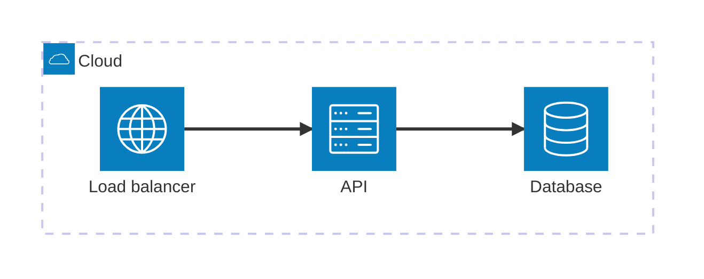

# archidraw

**Architecture as code.** Draw cloud and system architecture on a canvas, or write it as text.
Both views edit the same plain Mermaid file, so diagrams live in git, render on GitHub and GitLab,
and can be generated from your infrastructure code or by an AI assistant over MCP.

- **Two-way sync.** Edit the Mermaid `architecture-beta` text and the canvas follows; drag, connect,
  nest or rename on the canvas and the text is rewritten. Canvas positions are stored as
  `%% @pos` comments, which Mermaid ignores, so the file stays valid Mermaid everywhere.
- **Diagrams from infrastructure code.** Import Terraform, CloudFormation, Kubernetes manifests and
  Docker Compose files. Resources are nested into their networks, plumbing (IAM policies, route
  table associations…) is hidden, and references become connections.
- **MCP server.** `archidraw-mcp` lets Claude and other MCP clients create and edit diagrams and
  import infrastructure code. The app picks up those edits live in the file you have open.
- **Icons without legal trouble.** A vendor-neutral icon set (Lucide) is built in. Official AWS,
  Azure and Google Cloud packs are imported by each user from the vendor's download page; see
  [TRADEMARKS.md](TRADEMARKS.md).
- **Multilingual.** English, Hebrew, Arabic, Spanish, French, German, Japanese and Chinese, with
  full right-to-left support.
- **Cross-platform.** Runs in any modern browser today; a Windows/macOS/Linux desktop shell
  (Tauri) is planned.

## Example



## Getting started

Requires Node.js 20.19 or newer.

```bash
npm install
```

```bash
npm run dev
```

Then open http://localhost:5173.

### MCP server

```bash
npm run build -w archidraw-mcp
```

```bash
claude mcp add archidraw -- node packages/mcp/dist/index.js
```

See [packages/mcp/README.md](packages/mcp/README.md) for the full tool list and client configs.

## Project layout

| Package         | What it is                                                               |
| --------------- | ------------------------------------------------------------------------ |
| `packages/core` | Diagram model, Mermaid parser/serializer, IaC importers, ELK auto-layout |
| `packages/app`  | The editor (React, React Flow, CodeMirror, Mermaid)                      |
| `packages/mcp`  | The MCP server                                                           |

## Testing

| Command             | What runs                                                                      |
| ------------------- | ------------------------------------------------------------------------------ |
| `npm test`          | Unit tests (core, MCP tools, SVG sanitizer) and the MCP stdio integration test |
| `npm run test:e2e`  | Playwright smoke and acceptance tests against the production build             |
| `npm run lint`      | ESLint                                                                         |
| `npm run typecheck` | TypeScript across all packages                                                 |

CI runs all of them on Windows, macOS and Linux.

## License

[Apache License 2.0](LICENSE). Third-party notices are in [NOTICE](NOTICE). Vendor names are
trademarks of their owners; archidraw is not affiliated with any vendor.
