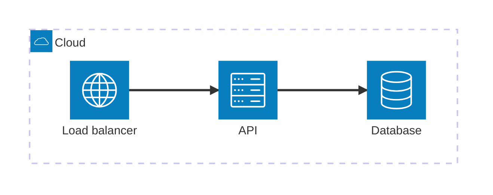

# OpsDraw

**Architecture as code.** Draw cloud and system architecture on a canvas, or write it as text.
Both views edit the same plain Mermaid file, so diagrams live in git, render on GitHub and GitLab,
and can be generated from your infrastructure code or by an AI assistant over MCP.

- **Two-way sync.** Edit the Mermaid `architecture-beta` text and the canvas follows; drag, connect,
  nest or rename on the canvas and the text is rewritten. Canvas positions are stored as
  `%% @pos` comments and auto-layout's orthogonal edge routes as `%% @route <from> <to> x,y …`
  comments, which Mermaid ignores, so the file stays valid Mermaid everywhere. Auto-layout gives
  each edge its own node side, as Mermaid requires, adding a junction where a node has more than
  four connections; re-imports place only new nodes, next to what they connect to.
- **Colors and legends.** Pick a color for a group or service in the inspector; it is stored as a
  `%% @style <id> fill=blue stroke=blue` comment (hex `#rgb`/`#rrggbb` or one of blue, green,
  orange, red, purple, gray, teal, yellow, which follow light/dark mode). Exports can add a legend
  of the icons and colors used, and edges that cross get a small line jump.
- **Diagrams from infrastructure code.** Import Terraform, CloudFormation, Kubernetes manifests
  (including OpenShift, KubeVirt, Gateway API, Helm/Flux/Argo apps), cluster configs (k0sctl, Talos,
  k3s/RKE2), Docker Compose, Ansible inventories and Nomad jobs. On-prem virtualization is covered
  through Terraform: Proxmox, VergeOS, vSphere, Xen Orchestra, Nutanix, oVirt, OpenStack,
  libvirt/KVM, LXD/Incus, Harvester, Rancher, Hyper-V and VirtualBox. Hosts, clusters and networks
  become nested groups, plumbing (IAM policies, NICs, route associations…) is hidden, and
  references become connections.
- **Exports that match the canvas.** SVG and PNG exports are drawn from your layout (not
  re-laid-out by Mermaid), use plain text that works in Inkscape, Confluence and other viewers,
  follow light/dark mode, and embed the diagram source, so an exported image can be reopened and
  edited.
- **MCP server.** `opsdraw-mcp` lets Claude and other MCP clients create and edit diagrams and
  import infrastructure code. The app picks up those edits live in the file you have open.
- **Icons without legal trouble.** A vendor-neutral icon set (Lucide) is built in. Official AWS,
  Azure and Google Cloud packs are imported by each user from the vendor's download page; see
  [TRADEMARKS.md](TRADEMARKS.md).
- **Multilingual.** English, Hebrew, Arabic, Spanish, French, German, Japanese and Chinese, with
  full right-to-left support.
- **Cross-platform.** Runs in any modern browser today; a Windows/macOS/Linux desktop shell
  (Tauri) is planned.

## Keep diagrams in sync with your infrastructure

The `opsdraw` CLI imports infrastructure code into a diagram and keeps your hand-made layout on
every re-import. In CI, `--check` fails when the committed diagram no longer matches the code:

```yaml
# .github/workflows/diagrams.yml
on: pull_request
jobs:
  diagram:
    runs-on: ubuntu-latest
    steps:
      - uses: actions/checkout@v4
      - uses: eran132/opsdraw@main
        with:
          source: infra
          diagram: docs/architecture.mmd
          recursive: true
```

Terraform and OpenTofu are read from source (`.tf`, `.tofu`, local modules, `count`/`for_each`)
or, for exact results, from `terraform show -json` / `tofu show -json` plan or state output. See
[packages/cli/README.md](packages/cli/README.md) for all commands.

## Example



## How OpsDraw compares

OpsDraw is narrower than general-purpose diagram tools: it is built for architecture diagrams
that live in git next to the infrastructure they describe.

|                                                   | OpsDraw                                          | draw.io                     | Excalidraw                  | Mermaid                    |
| ------------------------------------------------- | ------------------------------------------------ | --------------------------- | --------------------------- | -------------------------- |
| License                                           | Apache-2.0                                       | Apache-2.0                  | MIT                         | MIT                        |
| Visual editor                                     | Yes                                              | Yes                         | Yes (hand-drawn style)      | No (text only)             |
| Diagram as text                                   | Yes, two-way: text and canvas edit the same file | One-way import from Mermaid | One-way import from Mermaid | Yes                        |
| File format                                       | Mermaid `.mmd` with layout comments              | XML (`.drawio`)             | JSON (`.excalidraw`)        | Mermaid text               |
| Renders on GitHub/GitLab as-is                    | Yes (Mermaid)                                    | Via exported SVG/PNG        | Via exported SVG/PNG        | Yes                        |
| Manual layout kept in the file                    | Yes                                              | Yes                         | Yes                         | No (automatic layout only) |
| Import from Terraform, OpenTofu, Kubernetes, etc. | Yes, built in                                    | No                          | No                          | No                         |
| CI check that a diagram matches the code          | Yes (`opsdraw import --check`, GitHub Action)    | No                          | No                          | No                         |
| Git merge driver for diagram files                | Yes                                              | No                          | No                          | No                         |
| MCP server for AI assistants                      | Yes, local (stdio)                               | Yes, official               | Yes, official               | Community servers          |
| Vendor icons (AWS, Azure, GCP)                    | Imported by each user from the vendor            | Bundled                     | Community libraries         | Icon packs you register    |
| Desktop app                                       | Windows, macOS, Linux                            | Windows, macOS, Linux       | Web / installable web app   | No (CLI and renderers)     |

Hosted tools such as Eraser, Miro and Lucidchart also offer AI generation and MCP integrations;
they run in the vendor's cloud, so diagrams and prompts are processed on their servers.

Comparison as of October 2026. Products change quickly: if something here is out of date,
please [open an issue](https://github.com/eran132/opsdraw/issues). draw.io, Excalidraw, Mermaid,
Eraser, Miro and Lucidchart are trademarks of their respective owners; OpsDraw is not affiliated
with them.

## Getting started

Requires Node.js 20.19 or newer.

```bash
npm install
```

```bash
npm run dev
```

Then open http://localhost:5173.

### Keyboard shortcuts

On macOS, use Cmd instead of Ctrl. Canvas shortcuts apply while the canvas has focus; in the code editor and in text fields the keys keep their usual meaning.

| Keys                           | Action                                                                                       |
| ------------------------------ | -------------------------------------------------------------------------------------------- |
| Ctrl+D                         | Duplicate the selection next to it (a group brings everything inside it)                     |
| Ctrl+C / Ctrl+X                | Copy / cut the selection to the clipboard, as Mermaid text you can also paste into an editor |
| Ctrl+V                         | Paste at the pointer (into the group under it); pastes Mermaid copied from anywhere          |
| Delete / Backspace             | Delete the selection                                                                         |
| Arrow keys                     | Nudge the selection by 8 px                                                                  |
| Shift+arrow keys               | Nudge by 1 px                                                                                |
| Ctrl+Z / Ctrl+Y (Ctrl+Shift+Z) | Undo / redo a canvas edit                                                                    |
| Ctrl+S / Ctrl+Shift+S          | Save / save as                                                                               |
| Ctrl+O                         | Open a file                                                                                  |
| Shift+click / Shift+drag       | Add to the selection / draw a selection box                                                  |

Moving nodes (dragging, aligning, nudging) re-picks the attachment sides of their edges, so two nodes lined up get a straight edge.

### Command line

No install needed; npm runs it on demand:

```bash
npx opsdraw import infra --recursive -o docs/architecture.mmd
```

Or install it globally with `npm install -g opsdraw`. See [packages/cli/README.md](packages/cli/README.md).

### MCP server

Give Claude Code (or any MCP client) the diagram tools:

```bash
claude mcp add opsdraw -- npx -y opsdraw-mcp
```

See [packages/mcp/README.md](packages/mcp/README.md) for the full tool list and client configs.

## Project layout

| Package         | What it is                                                               |
| --------------- | ------------------------------------------------------------------------ |
| `packages/core` | Diagram model, Mermaid parser/serializer, IaC importers, ELK auto-layout |
| `packages/app`  | The editor (React, React Flow, CodeMirror, Mermaid)                      |
| `packages/cli`  | The `opsdraw` command-line tool and GitHub Action                        |
| `packages/mcp`  | The MCP server                                                           |

## Testing

| Command             | What runs                                                                      |
| ------------------- | ------------------------------------------------------------------------------ |
| `npm test`          | Unit tests (core, MCP tools, SVG sanitizer) and the MCP stdio integration test |
| `npm run test:e2e`  | Playwright smoke and acceptance tests against the production build             |
| `npm run lint`      | ESLint                                                                         |
| `npm run typecheck` | TypeScript across all packages                                                 |

CI runs all of them on Windows, macOS and Linux.

## License

[Apache License 2.0](LICENSE). Third-party notices are in [NOTICE](NOTICE). Vendor names are
trademarks of their owners; OpsDraw is not affiliated with any vendor.
